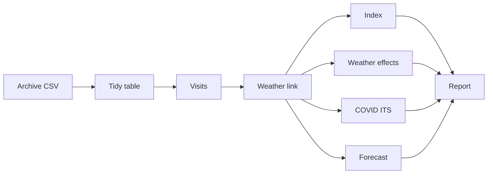
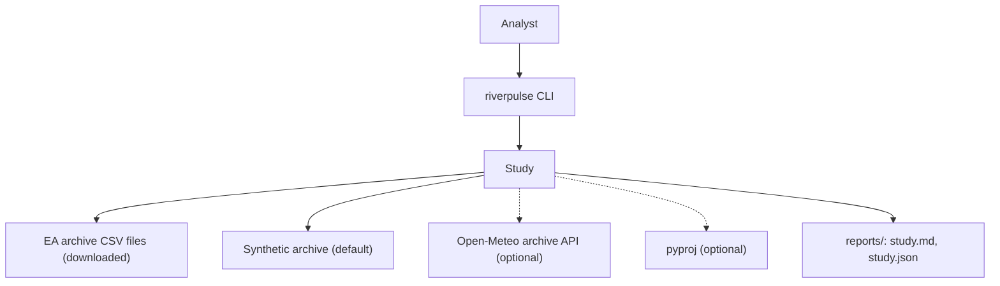
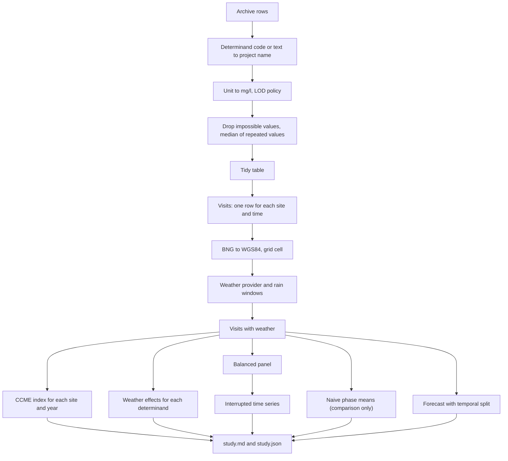

<div align="center">

# riverpulse — River Water Quality, Weather Effects and the COVID Effect

**riverpulse is an environmental-data study toolkit for river monitoring sites in England. It takes the Environment Agency water-quality archive through these steps to a water-quality index, weather effects and a COVID effect with confidence intervals:**

`ingest` → `convert units` → `link weather` → `index` → `model determinands` → `test COVID on a balanced panel`.


**[Summary](#1-summary)** ·
**[Workflow](#4-the-end-to-end-workflow)** ·
**[Run it](#13-how-to-run-riverpulse)** ·
**[Configuration](#134-environment-variables)** ·
**[Known problems](#16-known-problems)** ·
**[Glossary](#18-glossary)**

</div>

> [!NOTE]
> This README uses ASD-STE100 Simplified Technical English. The writing rules and the project
> vocabulary are in [`docs/ste-style-guide.md`](docs/ste-style-guide.md). Each term in the
> [Glossary](#18-glossary) has only one meaning.

---

riverpulse answers two questions about river water quality: how does the weather change the determinands, and did the COVID restrictions change them?
It models each determinand, not the index, so no result comes back from a formula.
The sampling changed during the restrictions. Thus the COVID test uses only the sites that were sampled in each period, with a trend and a season.
The index is the CCME Water Quality Index with explicit, two-sided objectives. A higher value is better water.
A synthetic archive with known effects lets the tests check that the analysis recovers the true numbers.

This README is the **one location that explains all of riverpulse**. It gives these topics:

- the general design
- each component and its procedure, step by step
- the decision rules
- the data map
- the runbook
- the validation results and the known problems

| If you are… | Read |
|---|---|
| A manager or reviewer | [1](#1-summary), [3](#3-design-rules), [4](#4-the-end-to-end-workflow), [15](#15-validation-results), [17](#17-key-points) |
| A developer who joins the project | All sections, in sequence. Keep [13](#13-how-to-run-riverpulse) and [16](#16-known-problems) open while you work |
| An operator who runs riverpulse | [13](#13-how-to-run-riverpulse), then the section for the component that you use |

---

## Table of contents

1. 🧭 [Summary](#1-summary)
2. 🏗️ [How riverpulse is built](#2-how-riverpulse-is-built)
   - 2.1 [Components](#21-components)
   - 2.2 [System context](#22-system-context)
   - 2.3 [Repository layout](#23-repository-layout)
3. 🛡️ [Design rules](#3-design-rules)
4. 🔄 [The end-to-end workflow](#4-the-end-to-end-workflow)
   - 4.1 [Full flow](#41-full-flow)
   - 4.2 [The life cycle of one measurement](#42-the-life-cycle-of-one-measurement)
5. 📥 [Ingest and units](#5-ingest-and-units)
6. 🌦️ [Weather linkage](#6-weather-linkage)
7. ⚖️ [The water-quality index](#7-the-water-quality-index)
8. 🔵 [Weather effects](#8-weather-effects)
9. 🟢 [The COVID effect](#9-the-covid-effect)
10. 🟣 [The determinand forecast](#10-the-determinand-forecast)
11. 🧪 [The synthetic archive](#11-the-synthetic-archive)
12. 🗂️ [Data and file map](#12-data-and-file-map)
13. ▶️ [How to run riverpulse](#13-how-to-run-riverpulse)
    - 13.1 [Prerequisites](#131-prerequisites) · 13.2 [Installation](#132-installation) · 13.3 [Run riverpulse](#133-run-riverpulse) · 13.4 [Environment variables](#134-environment-variables)
14. 🧩 [How to extend riverpulse](#14-how-to-extend-riverpulse)
15. ✅ [Validation results](#15-validation-results)
16. ⚠️ [Known problems](#16-known-problems)
17. 📌 [Key points](#17-key-points)
18. 📖 [Glossary](#18-glossary)
19. 📄 [License](#19-license)

---

## 1. Summary

**The problem.** Monitoring data shows many patterns, but a wrong design turns a pattern into a false finding. These questions are difficult:

- How do you measure the effect of the weather without a model that only learns its own formula?
- How do you compare periods when the sampled sites change between the periods?
- Which objectives make a fair index, for example for pH, oxygen and nitrate as N?
- How do you treat a missing measurement or a pollution spike without a change of the data?
- How do you link each site to the weather of its own place?

riverpulse gives each of these questions its own component. Each component has a test with a known answer.

| Item | Value |
|---|---|
| Input | Environment Agency archive CSV files, or the synthetic archive |
| Output | Tidy table, index for each site and year, weather coefficients, COVID effect, forecast scores, `study.md` and `study.json` |
| Determinands | pH, water temperature, ammonia as N, nitrate as N, orthophosphate as P, dissolved oxygen, BOD |
| Weather | Synthetic, Open-Meteo for each grid cell, or fixed station files with a distance limit |
| Statistics | OLS with site fixed effects and cluster-robust (CR1) standard errors by site |
| Offline mode | All commands with the synthetic archive and synthetic weather |
| Safety | No value is imputed across visits, and no spike is smoothed |
| Tests | **25** unit tests (`pytest`), 1 more skips without `pyproj` |



---

## 2. How riverpulse is built

### 2.1 Components

| Component | Module | Purpose |
|---|---|---|
| Settings | `src/riverpulse/config.py` | Environment variables, `.env` loader, COVID dates |
| Units | `src/riverpulse/units.py` | EA determinand codes, unit factors, valid ranges |
| Ingest | `src/riverpulse/ingest.py` | Archive rows to the tidy table, LOD policy, visits, sampling summary |
| Geo | `src/riverpulse/geo.py` | BNG to WGS84 (numpy or `pyproj`), distances, grid cells |
| Weather | `src/riverpulse/weather.py` | Synthetic, Open-Meteo and station providers, antecedent rain |
| Index | `src/riverpulse/wqi.py` | CCME index, objectives, categories, exceedances |
| Statistics | `src/riverpulse/stats.py` | OLS with fixed effects and cluster-robust errors, season terms |
| Analysis | `src/riverpulse/analysis.py` | Weather effects, balanced panel, interrupted time series, naive means |
| Forecast | `src/riverpulse/forecast.py` | Temporal split, grouped CV, climatology baseline |
| Synthetic archive | `src/riverpulse/synthetic.py` | EA-format data with known effects |
| Study | `src/riverpulse/study.py` | Full study, text output, report files |
| CLI | `src/riverpulse/cli.py` | The `riverpulse` command with 8 subcommands |

### 2.2 System context



### 2.3 Repository layout

```
riverpulse/
├── .github/workflows/ci.yml     # CI: Python 3.11, pip install -e ".[dev]", pytest -q
├── .env.example                 # every environment variable, all values empty
├── pyproject.toml               # package, extras (geo, dev), riverpulse script
├── data/README.md               # sources, licences, determinand codes, weather modes
├── docs/ste-style-guide.md      # writing rules and project vocabulary
├── src/riverpulse/
│   ├── config.py  units.py  ingest.py  geo.py  weather.py
│   ├── wqi.py  stats.py  analysis.py  forecast.py
│   ├── synthetic.py  study.py  cli.py
└── tests/                       # 26 tests (25 run without pyproj), no network
```

---

## 3. Design rules

### 3.1 The models explain determinands, not the index
The index is a fixed function of the determinands. A model that predicts the index from the same determinands only learns the formula. riverpulse models each determinand from the season, the weather and the site. `forecast` refuses a target that is not a determinand.

### 3.2 A period comparison uses the same sites
`balanced_panel` keeps only sites with at least `RIVERPULSE_MIN_SAMPLES` measurements in each period. The interrupted time series has a site effect, a trend and a season. The report also shows the naive phase means, so the reader can see the difference.

### 3.3 Each objective is explicit
pH has a range of 6 to 9. Dissolved oxygen has a minimum. Nitrate is "as N" with 11.3 mg/l. Temperature fails only above 25 °C. The CCME formula caps the amplitude, and a higher index is always better.

### 3.4 No measurement is invented or removed
A determinand that a visit did not measure stays missing. A spike stays in the data and counts as an exceedance. Only a physically impossible value (for example pH 19) is dropped, and the report counts it.

### 3.5 Each site gets its own weather
Each site gets the weather of its own 0.1-degree grid cell, with rain sums over 1, 3, 7 and 14 days. With fixed stations, a site farther than `RIVERPULSE_MAX_STATION_KM` gets no weather.

### 3.6 Uncertainty is always reported
Each coefficient has a 95 % interval with standard errors clustered by site. The forecast uses a temporal split and grouped cross-validation by site.

---

## 4. The end-to-end workflow

### 4.1 Full flow



### 4.2 The life cycle of one measurement

1. The archive row gives a site, a time, a determinand code, a result, a qualifier and a unit.
2. `canonical_name` maps the code to a project name, for example `0111` to `ammonia_n`.
3. `to_mg_per_l` converts the unit. A result with `<` gets half the LOD (default) and a flag.
4. The range check drops a physically impossible value.
5. `visits` puts the value in the row of its visit. Other visits do not get it.
6. `site_weather` adds the weather and the rain sums of the visit date.
7. The analysis uses the value in the index, the weather model, the COVID model and the forecast.

---

## 5. Ingest and units

**Purpose.** Change the archive rows into one clean measurement for each site, time and determinand.

| LOD policy (`RIVERPULSE_LOD_POLICY`) | Value of a `<` result |
|---|---|
| `half` (default) | LOD ÷ 2 |
| `lod` | LOD |
| `drop` | The row is removed |

| Unit label | Factor to mg/l |
|---|---|
| `mg/l` | 1 |
| `ug/l`, `µg/l` | 0.001 |
| `ng/l` | 0.000001 |
| `phunits`, `cel`, `%` | 1 (no conversion) |

| Determinand | Valid range |
|---|---|
| `ph` | 0 to 14 |
| `temp_c` | −1 to 40 °C |
| `ammonia_n` | 0 to 500 mg/l |
| `nitrate_n` | 0 to 200 mg/l |
| `orthophosphate_p` | 0 to 100 mg/l |
| `do_mg` | 0 to 25 mg/l |

**Rules**

- A result with `>` (above the upper limit of the method) is removed and counted.
- Repeated measurements of one determinand at one visit become their median.
- `sampling_summary` gives the visits and sites for each year, so a change of the sampling design is visible.

---

## 6. Weather linkage

**Purpose.** Give each visit the weather of its own place and the rain before the visit.

**Procedure**

1. Convert the site easting and northing to WGS84 (`pyproj` if installed, else the Ordnance Survey formulas and a Helmert transformation, about 5 m accuracy).
2. Find the 0.1-degree grid cell of each site.
3. Get the daily weather of each cell from the provider, from 20 days before the first visit to the last visit.
4. Calculate the rain sums over 1, 3, 7 and 14 days that end on each date.
5. Join the weather to the visits on site and date.

| Provider | Behaviour |
|---|---|
| `SyntheticWeather` | One fixed seeded series for each cell from 2000 to 2035, sliced on request |
| `OpenMeteoProvider` | One call to the Open-Meteo archive API for each cell, cached as JSON |
| `StationWeather` | Nearest fixed station if it is within `RIVERPULSE_MAX_STATION_KM`, else no weather |

---

## 7. The water-quality index

**Purpose.** Give a summary of water quality for a site and a year.

| Determinand | Objective | Type |
|---|---|---|
| `ph` | 6.0 to 9.0 | Range |
| `do_mg` | ≥ 6.0 mg/l | Minimum |
| `ammonia_n` | ≤ 0.6 mg/l as N | Maximum |
| `orthophosphate_p` | ≤ 0.1 mg/l as P | Maximum |
| `nitrate_n` | ≤ 11.3 mg/l as N (50 mg/l as NO3) | Maximum |
| `temp_c` | ≤ 25 °C | Maximum |

**Procedure (CCME)**

1. F1 = 100 × failed determinands ÷ measured determinands.
2. F2 = 100 × failed measurements ÷ all measurements.
3. For each failed measurement, excursion = value ÷ objective − 1 (maximum) or objective ÷ value − 1 (minimum).
4. nse = sum of excursions ÷ all measurements. F3 = nse ÷ (0.01 nse + 0.01).
5. Index = 100 − √(F1² + F2² + F3²) ÷ 1.732.

| Index | Category |
|---|---|
| 95 to 100 | excellent |
| 80 to 94 | good |
| 65 to 79 | fair |
| 45 to 64 | marginal |
| 0 to 44 | poor |

A group with fewer than 4 determinands or 4 measurements gets "insufficient data". The objectives are screening values for this project. They are not a legal classification.

---

## 8. Weather effects

**Purpose.** Measure how temperature and rain change each determinand.

**Model.** `y = site effect + 2 season harmonics + b1 tmean + b2 rain_3d + b3 rain_7d + b4 rain_14d + error`.

| Rule | Value |
|---|---|
| Response | Natural log for `ammonia_n`, `orthophosphate_p`, `nitrate_n`, `bod`. Raw value for the others |
| Fixed effects | One for each site |
| Standard errors | CR1, clustered by site |
| Minimum data | 3 sites and 50 rows with weather |

For a log response, 100 × b is about the percent change for one unit of the weather term.

---

## 9. The COVID effect

**Purpose.** Estimate the change of a determinand during and after the restrictions, with the same sites in each period.

| Period | Dates (default) |
|---|---|
| `before` | Before `RIVERPULSE_COVID_START` (2020-03-23) |
| `during` | 2020-03-23 to `RIVERPULSE_COVID_END` (2021-07-19) |
| `after` | After 2021-07-19 |

**Procedure**

1. Keep the sites with at least `RIVERPULSE_MIN_SAMPLES` (default 3) measurements in each period.
2. Fit `y = site effect + trend (years) + during + after + 2 season harmonics + error`.
3. Report the coefficients of `trend_years`, `during` and `after` with 95 % intervals.
4. For a log response, report the effect as 100 × (exp(b) − 1) percent.
5. Report the naive phase means next to the model, as a comparison only.

---

## 10. The determinand forecast

**Purpose.** An optional machine-learning check: forecast one determinand (default `do_mg`) for later visits.

| Item | Value |
|---|---|
| Split | Train on visits up to the cut-off date (default 2021-12-31), test on later visits |
| Model | `HistGradientBoostingRegressor(max_iter=200, learning_rate=0.05)` |
| Features | `tmean`, rain sums, 2 season harmonics, training mean of the site |
| Baseline | Training mean of the same site and calendar month |
| Unseen sites | 5-fold `GroupKFold` by site on the training part |

---

## 11. The synthetic archive

**Purpose.** Give the demo and the tests an archive with known effects and the defects of the real archive.

| Item | Value in `make_archive` |
|---|---|
| Sites | 60 (default), random BNG coordinates in Cambridgeshire and Bedfordshire |
| Visits | About 1 visit each month (80 %), 2015 to 2024 |
| COVID sampling | Few visits, and cleaner sites have a higher visit rate |
| Ammonia | Site level, season, trend −0.03 per year, +0.03 for each mm of 3-day rain, −0.15 during COVID (log scale), 1 % spikes × 5 |
| Orthophosphate | Site level, +0.012 for each mm of 7-day rain, trend −0.02 per year (log scale), 20 % of rows in ug/l |
| Dissolved oxygen | Site level −0.22 mg/l for each °C of air temperature |
| Missing values | Each determinand is absent from 12 % of visits |
| LOD | Ammonia below 0.03 mg/l is written as `<` 0.03 |

The true values are in `riverpulse.synthetic.TRUTH`.

---

## 12. Data and file map

| Path | Committed? | Contents |
|---|---|---|
| `data/README.md` | Yes | Sources, licences, codes, weather modes |
| `data/*.csv` | No (git ignores it) | Archive files, synthetic archive, tidy table, station files |
| `data/weather_cache/*.json` | No (git ignores it) | Open-Meteo replies |
| `reports/study.md`, `reports/study.json` | No (git ignores it) | The output of `riverpulse study` |
| `.env` | No (git ignores it) | Local settings |
| `.env.example` | Yes | All variable names, no values |

---

## 13. How to run riverpulse

### 13.1 Prerequisites

| Need | For |
|---|---|
| Python 3.11+ | All components |
| `numpy`, `pandas`, `scikit-learn>=1.4` | Core (installed with the package) |
| `pyproj` (extra `geo`) | Exact coordinate conversion (optional) |
| Network access | `--weather open-meteo` only |

### 13.2 Installation

```bash
git clone https://github.com/KrishnaAnnavaram/riverpulse.git
cd riverpulse
python -m venv .venv
. .venv/bin/activate            # Windows: .venv\Scripts\activate
pip install -e ".[dev]"         # add ,geo for pyproj
```

### 13.3 Run riverpulse

Offline (no key, no network):

```bash
riverpulse demo                                          # full study on the synthetic archive
riverpulse generate --out data/synthetic_archive.csv --sites 60
riverpulse ingest --csv data/synthetic_archive.csv --out data/tidy.csv
riverpulse index --out reports/index.csv
riverpulse weather-effects --determinands ammonia_n,do_mg
riverpulse covid --determinands ammonia_n
riverpulse forecast --target do_mg --cutoff 2021-12-31
riverpulse study --out reports
```

With the real archive and real weather:

```bash
riverpulse study --csv data/CB-2015-M.csv data/CB-2016-M.csv data/CB-2017-M.csv --weather open-meteo
riverpulse study --csv data/CB-*.csv --weather stations \
    --station cambridge,52.1968,0.1661,data/cambridge.csv --station bedford,52.1265,-0.4973,data/bedford.csv
```

| Command | What it does |
|---|---|
| `demo` | Runs the full study on the synthetic archive and prints it |
| `generate` | Writes a synthetic archive CSV in the EA format |
| `ingest` | Reads archive CSV files and writes the tidy table |
| `index` | Prints and writes the CCME index for each site and year |
| `weather-effects` | Prints the weather coefficients for each determinand |
| `covid` | Prints the interrupted time series and the naive phase means |
| `forecast` | Prints the forecast scores |
| `study` | Runs everything and writes `study.md` and `study.json` |

### 13.4 Environment variables

| Variable | Used by | Meaning |
|---|---|---|
| `RIVERPULSE_DATA_DIR` | Weather cache | Data folder. Default `data` |
| `RIVERPULSE_OUT` | `study` | Output folder. Default `reports` |
| `RIVERPULSE_SEED` | Synthetic data, forecast | Seed. Default 42 |
| `RIVERPULSE_LOD_POLICY` | Ingest | `half` (default), `lod` or `drop` |
| `RIVERPULSE_MAX_STATION_KM` | Station weather | Maximum distance to a station. Default 25 |
| `RIVERPULSE_MIN_SAMPLES` | COVID panel | Minimum measurements of a site in each period. Default 3 |
| `RIVERPULSE_COVID_START` | COVID analysis | Start of the restrictions. Default 2020-03-23 |
| `RIVERPULSE_COVID_END` | COVID analysis | End of the restrictions. Default 2021-07-19 |

The CLI reads a local `.env` file. A variable that is already in the environment wins. A value that is not valid stops the command with `error:`. riverpulse needs no credentials.

---

## 14. How to extend riverpulse

| You want to… | Do this | Code change? |
|---|---|---|
| Use a different area | Download its archive files and give them to `--csv` | No |
| Change a COVID date | Set `RIVERPULSE_COVID_START` or `RIVERPULSE_COVID_END` | No |
| Change an objective | Edit `OBJECTIVES` in `wqi.py` | Small |
| Add a determinand | Add its code to `DETERMINANDS`, its range to `VALID_RANGES` and an objective | Small |
| Add a weather provider | Write a class with `daily(lat, lon, start, end)` | Small |
| Add a mixed model or a GAM | Add a function next to `weather_effects` with an optional dependency | Yes |

Planned milestones (not built):

- **M6:** maps of sites, index categories and effects.
- **M7:** a difference-in-differences design with a control region.
- **M8:** sensitivity checks for the LOD policy, the panel threshold and the COVID dates.

---

## 15. Validation results

All numbers come from the **synthetic** archive (60 sites, seed 42, 27,410 measurements). They are not findings about real rivers.

| Validation | Result | Command |
|---|---|---|
| Unit tests | **25 passed**, 1 skipped (`pyproj` absent) | `pytest -q` |
| Unit tests with `pyproj` | The skipped test also passes | `pip install -e ".[dev,geo]"` |
| Expected CI (fresh venv, `pip install -e ".[dev]"`) | **25 passed**, 1 skipped | `.github/workflows/ci.yml` |
| Ammonia, 3-day rain (true 0.03) | 0.0287 [0.0255, 0.0319] | `riverpulse demo` |
| Orthophosphate, 7-day rain (true 0.012) | 0.0120 [0.0101, 0.0139] | `riverpulse demo` |
| Dissolved oxygen, air temperature (true −0.22) | −0.2218 [−0.2293, −0.2143] | `riverpulse demo` |
| Ammonia during COVID (true −13.9 %) | −9.5 % [−19.4, +1.6] on 25 of 60 sites | `riverpulse demo` |
| Ammonia, naive phase means | before 0.2186, during 0.1141 mg/l: −48 % | `riverpulse demo` |
| Index by year | 82.1 to 84.0 in 2015–2019, 85.7 and 85.6 in 2020–2021 | `riverpulse demo` |
| Dissolved oxygen forecast after 2021 | MAE 0.518 (model), 0.682 (site-month climatology), 0.826 (grouped CV, unseen sites) | `riverpulse demo` |
| BNG conversion | OSGB36 equal to the Ordnance Survey example to 1e-6 degrees | `pytest` |

The models recover each true weather effect inside the 95 % interval, and the no-effect terms include 0.
The interrupted time series includes the true COVID effect. The naive phase means show a change more than three times too large, because the cleaner sites were sampled more during COVID.
The index also looks better in 2020–2021 for the same reason. Thus a rise of the index in those years is not evidence of cleaner water.
The prototype reported an R² above 0.99 for the index (prototype result, not reproduced here). That value came from a model of the index formula itself.

---

## 16. Known problems

Read these problems before you use riverpulse in production.

| # | Area | Problem | Impact and action |
|---|---|---|---|
| 1 | Data | CI and the demo use only synthetic data. Results on the real archive are not reproduced | Run `riverpulse study` on the archive files before you report a finding |
| 2 | Objectives | The objectives are screening values, not the site-specific standards of the Water Framework Directive | Replace `OBJECTIVES` with the standards of your river type |
| 3 | COVID design | The interrupted time series has no control region. Other changes at the same time can look like a COVID effect | Add a control region (M7) and read the trend term |
| 4 | Panel | The balanced panel can be small (25 of 60 synthetic sites) and can differ from the full network | Report the panel size, and test other thresholds (M8) |
| 5 | Weather | Air temperature and grid-cell rain are proxies for water temperature and catchment rain | Use river flow data when it is available |
| 6 | LOD | Half the LOD is a convention. Many results below the LOD can bias a nutrient model | Compare the `half`, `lod` and `drop` policies |
| 7 | Archive service | The archive download service and its column names can change | Check the columns in section 5 against new files |
| 8 | Statistics | The standard errors assume independent sites. Sites on one river can correlate | Cluster by catchment when the catchment is known |

---

## 17. Key points

1. **Determinands are modelled, not the index.** No result comes from the index formula itself.
2. **The same sites are compared in each period.** The balanced panel and the trend remove the sampling bias that the naive means show.
3. **The index has explicit objectives and one direction.** Two-sided pH, nitrate as N, oxygen minimum, higher is better.
4. **No measurement is invented or smoothed.** Missing values stay missing, and spikes stay as exceedances.
5. **Each site gets its own weather.** Grid-cell weather with antecedent rain, and a distance limit for fixed stations.
6. **The analysis recovers known effects.** The synthetic archive tests each estimate against its true value.

---

## 18. Glossary

| Term | Meaning |
|---|---|
| **Antecedent rain** | Rain sum over the days that end on the visit date |
| **Balanced panel** | The sites with enough measurements in each period |
| **BNG** | British National Grid coordinates (EPSG:27700) |
| **CCME index** | The water-quality index of the Canadian Council of Ministers of the Environment, 0 to 100, higher is better |
| **Climatology** | The training mean of one site and calendar month |
| **Determinand** | One measured property of the water |
| **Exceedance** | A measurement outside its objective |
| **Grid cell** | The 0.1-degree cell that gives the weather of a site |
| **Interrupted time series** | A regression with a trend, a season and period terms |
| **LOD** | Limit of detection |
| **Naive phase means** | Means of all visits in each period, with no site matching |
| **Objective** | The screening limit of a determinand in the index |
| **Period** | `before`, `during` or `after` the COVID restrictions |
| **Visit** | All measurements of one site at one date and time |

---

## 19. License

[MIT](LICENSE) © 2026 Krishna Annavaram
